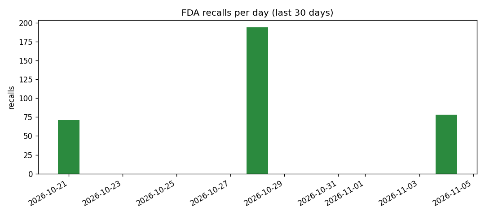

# FDA Recall Radar




A self-updating data project that tracks U.S. FDA enforcement reports (recalls)
across drugs, food and medical devices. Every day it pulls the last 30 days of
reports from the [openFDA](https://open.fda.gov/) API, archives new recalls into
a growing history file, and regenerates a markdown report with a trend chart.

Data source: openFDA enforcement endpoints. No API key needed.

## What it does

- Fetches recall enforcement reports for `drug`, `food` and `device` product areas
- Dedupes on `recall_number` and archives every new recall into `data/recalls_history.csv`
- Summarizes severity (Class I/II/III), product areas and top recalling firms
- Highlights the most severe recent recalls
- Writes `reports/daily_report.md` plus a recalls-per-day chart

## Layout

```
src/recallradar/    library code: api client, analysis, report rendering
scripts/            daily_update.py - the one-command daily refresh
tests/              pytest suite (runs fully offline; API client uses a fake session)
data/               recalls_history.csv, the growing archive
reports/            generated daily report and chart
```

## Quickstart

```bash
pip install -r requirements.txt
python scripts/daily_update.py   # fetch, archive, regenerate report
python scripts/query.py firm "par health"   # read-only archive lookups: recall, firm, theme
python -m pytest                 # run the test suite
```

## Daily updates

`scripts/daily_update.py` is idempotent: re-running it only archives recalls it
has not seen before. It runs once a day and each run is merged back to `main`,
so the history file and report grow day by day. New analysis features and tests
are added on a daily cadence too. The latest generated report lives at
[reports/daily_report.md](reports/daily_report.md); days openFDA has not
published yet are shaded on the chart.

## Notes

openFDA data is not validated for medical decisions. This project is for
learning and portfolio purposes.

## Committing

`scripts/safe_commit.sh "message"` runs the test suite and commits only if it passes (fail-closed: a failing test, a collection error or no passing tests blocks the commit). It does not push.
