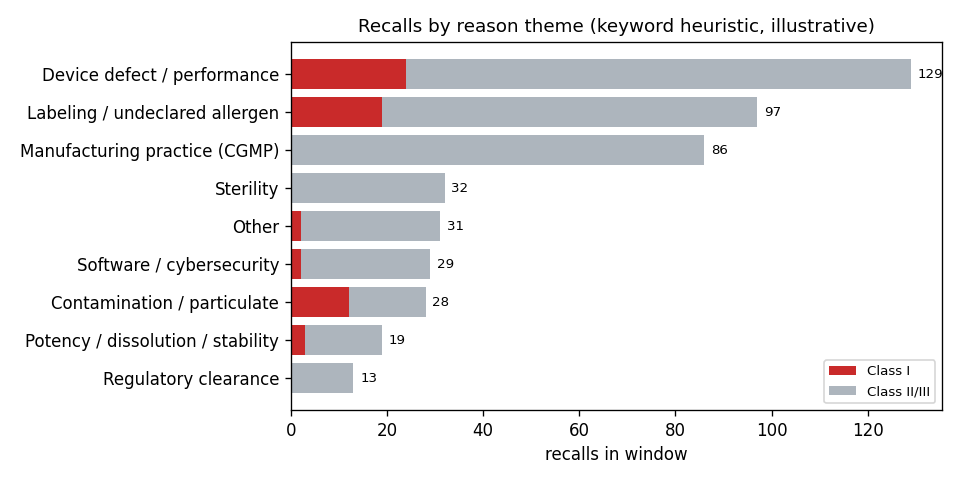

# FDA Recall Radar - daily report

Window: 2026-10-20 to 2026-11-19 (by report date). openFDA last_updated by endpoint: device 2026-11-11, drug 2026-11-11, food 2026-11-11. Generated 2026-11-19 20:04 UTC.

**464 recalls** across 4 active days.

## By severity

| Classification | Recalls |
| --- | ---: |
| Class I | 62 |
| Class II | 363 |
| Class III | 37 |

## By product area

| Product type | Recalls |
| --- | ---: |
| Devices | 235 |
| Drugs | 124 |
| Food | 105 |

## Reporting lag

Days from recall initiation to the enforcement report, over the 464 recalls in the window with both dates: median **43.0**, p90 65, longest 917.

| Classification | Recalls | Median lag | p90 |
| --- | ---: | ---: | ---: |
| Class I | 62 | 41.0 | 65 |
| Class II | 363 | 43 | 65 |
| Class III | 37 | 65 | 65 |

## Top recalling firms

- El Ruisenor De Mexico, Inc. (61)
- Victory Medical Center Pharmacy (42)
- Boston Scientific Cork, Ltd. (41)
- Medline Industries, LP (32)
- ABC Compounding Co., Inc. (19)
- PRITAM INTERNATIONAL PRIVATE LIMITED (17)
- Henry Schein Inc. (13)
- Ventec Life Systems, Inc. (12)
- Cardinal Health 200, LLC (11)
- PHILIPS MEDICAL SYSTEMS NEDERLAND B.V. (9)

## Severity by product area

| Product type | Class I | Class II | Class III | Class I share |
| --- | ---: | ---: | ---: | ---: |
| Devices | 31 | 203 | 1 | 13% |
| Drugs | 3 | 116 | 4 | 2% |
| Food | 28 | 44 | 32 | 27% |

## Recalls by week

| Week of | Recalls | Class I |
| --- | ---: | ---: |
| 2026-10-19 | 70 | 3 |
| 2026-10-26 | 194 | 25 |
| 2026-11-02 | 77 | 12 |
| 2026-11-09 | 123 | 22 |

## Recall reason themes

Keyword grouping of the free-text reason (illustrative heuristic, not an FDA taxonomy).

| Theme | Recalls | Class I |
| --- | ---: | ---: |
| Device defect / performance | 129 | 24 |
| Labeling / undeclared allergen | 97 | 19 |
| Manufacturing practice (CGMP) | 86 | 0 |
| Sterility | 32 | 0 |
| Other | 31 | 2 |
| Software / cybersecurity | 29 | 2 |
| Contamination / particulate | 28 | 12 |
| Potency / dissolution / stability | 19 | 3 |
| Regulatory clearance | 13 | 0 |

## Top reason theme by product area

| Product area | Recalls | Top theme | Share of area |
| --- | ---: | --- | ---: |
| Devices | 235 | Device defect / performance | 54% |
| Drugs | 124 | Manufacturing practice (CGMP) | 68% |
| Food | 105 | Labeling / undeclared allergen | 79% |

## Recall status

| Status | Recalls | Share |
| --- | ---: | ---: |
| Ongoing | 463 | 100% |
| Completed | 1 | 0% |

_Window total includes 2 recalls with no recall_number; they are reported here but cannot be keyed into the archive._

## Repeat recallers

Firms with 3+ recalls in the window (a supplier-risk signal).

| Firm | Recalls | Class I |
| --- | ---: | ---: |
| El Ruisenor De Mexico, Inc. | 61 | 5 |
| Victory Medical Center Pharmacy | 42 | 0 |
| Boston Scientific Cork, Ltd. | 41 | 0 |
| Medline Industries, LP | 32 | 0 |
| ABC Compounding Co., Inc. | 19 | 0 |

## Highest-severity recalls in the window

- **Class I** (20261111): Family Farmstead Dairy, LLC - Potential contamination with E. coli (pathogenic non-O157 STEC).
- **Class I** (20261111): Krasnyi Oktyabr Inc - Contaminated with Listeria monocytogenes
- **Class I** (20261111): Krasnyi Oktyabr Inc - Contaminated with Listeria monocytogenes
- **Class I** (20261111): Lidl US TRADING - Listeria monocytogenes. The firm received positive test result of Listeria monocytogenes in the product.
- **Class I** (20261111): Lockout Industries, LLC - FDA analysis revealed the presence of undeclared sildenafil.

Data: [openFDA](https://open.fda.gov/) enforcement reports. Not medical advice.
