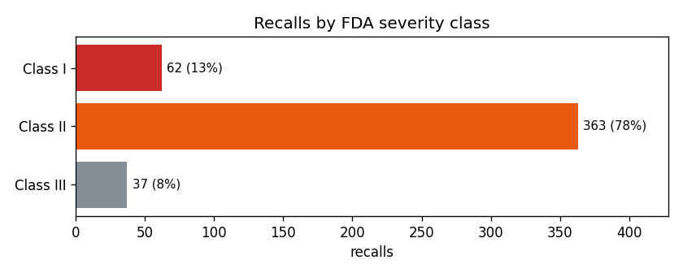

# FDA Recall Radar - daily report

Window: 2026-10-24 to 2026-11-23 (by report date). openFDA last_updated by endpoint: device 2026-11-11, drug 2026-11-11, food 2026-11-11. Generated 2026-11-23 20:07 UTC.

**394 recalls** across 3 active days.

> **Stale upstream data:** openFDA has not published for over 7 days (device 12 days, drug 12 days, food 12 days). Recent days may be missing here until it does.

## By severity

| Classification | Recalls |
| --- | ---: |
| Class I | 59 |
| Class II | 298 |
| Class III | 35 |

## By product area

| Product type | Recalls |
| --- | ---: |
| Devices | 177 |
| Drugs | 119 |
| Food | 98 |

## Reporting lag

Days from recall initiation to the enforcement report, over the 394 recalls in the window with both dates: median **43.0**, p90 65, longest 917.

| Classification | Recalls | Median lag | p90 |
| --- | ---: | ---: | ---: |
| Class I | 59 | 41 | 65 |
| Class II | 298 | 42.0 | 65 |
| Class III | 35 | 65 | 65 |

Lag by product type (days, slowest first):

| Product type | Recalls | Median lag | p90 |
| --- | ---: | ---: | ---: |
| Food | 98 | 65 | 65 |
| Devices | 177 | 43 | 64 |
| Drugs | 119 | 27 | 48 |

Slowest to reach the enforcement report (dates as published by openFDA; very long lags may be old recalls newly classified or source date errors):

| Recall | Firm | Class | Lag (days) |
| --- | --- | --- | ---: |
| Z-0320-2027 | Illumina, Inc. | Class II | 917 |
| Z-0321-2027 | Illumina, Inc. | Class II | 917 |
| Z-0322-2027 | Illumina, Inc. | Class II | 917 |
| Z-0323-2027 | Illumina, Inc. | Class II | 917 |
| Z-0324-2027 | Illumina, Inc. | Class II | 917 |

## Top recalling firms

- El Ruisenor De Mexico, Inc. (61)
- Victory Medical Center Pharmacy (42)
- Boston Scientific Cork, Ltd. (41)
- ABC Compounding Co., Inc. (19)
- PRITAM INTERNATIONAL PRIVATE LIMITED (17)
- Henry Schein Inc. (13)
- Medline Industries, LP (13)
- Ventec Life Systems, Inc. (12)
- Cardinal Health 200, LLC (11)
- PHILIPS MEDICAL SYSTEMS NEDERLAND B.V. (9)

## Severity by product area

| Product type | Class I | Class II | Class III | Class I share |
| --- | ---: | ---: | ---: | ---: |
| Devices | 29 | 148 | 0 | 16% |
| Drugs | 3 | 111 | 4 | 3% |
| Food | 27 | 39 | 31 | 28% |

## Recalls by week

| Week of | Recalls | Class I |
| --- | ---: | ---: |
| 2026-10-26 | 194 | 25 |
| 2026-11-02 | 77 | 12 |
| 2026-11-09 | 123 | 22 |

## Recall reason themes

Keyword grouping of the free-text reason (illustrative heuristic, not an FDA taxonomy).

| Theme | Recalls | Class I |
| --- | ---: | ---: |
| Device defect / performance | 98 | 24 |
| Labeling / undeclared allergen | 88 | 18 |
| Manufacturing practice (CGMP) | 85 | 0 |
| Software / cybersecurity | 26 | 0 |
| Sterility | 24 | 0 |
| Contamination / particulate | 22 | 12 |
| Other | 20 | 2 |
| Potency / dissolution / stability | 18 | 3 |
| Regulatory clearance | 13 | 0 |

## Top reason theme by product area

| Product area | Recalls | Top theme | Share of area |
| --- | ---: | --- | ---: |
| Devices | 177 | Device defect / performance | 55% |
| Drugs | 119 | Manufacturing practice (CGMP) | 70% |
| Food | 98 | Labeling / undeclared allergen | 80% |

## Top recalling firms by product area

| Product area | Firm | Recalls | Class I |
| --- | --- | ---: | ---: |
| Devices | Boston Scientific Cork, Ltd. | 41 | 0 |
| Devices | Henry Schein Inc. | 13 | 0 |
| Devices | Medline Industries, LP | 13 | 0 |
| Drugs | Victory Medical Center Pharmacy | 42 | 0 |
| Drugs | ABC Compounding Co., Inc. | 19 | 0 |
| Drugs | PRITAM INTERNATIONAL PRIVATE LIMITED | 17 | 0 |
| Food | El Ruisenor De Mexico, Inc. | 61 | 5 |
| Food | GF Blends Inc | 3 | 3 |
| Food | Oliva on Main | 3 | 3 |

## Recall status

| Status | Recalls | Share |
| --- | ---: | ---: |
| Ongoing | 393 | 100% |
| Completed | 1 | 0% |

## Age of open recalls

Days since initiation for recalls still marked Ongoing.

| Class | Open | Median age (days) | Oldest (days) | Open > 90 days |
| --- | ---: | ---: | ---: | ---: |
| Class I | 58 | 60 | 271 | 9 |
| Class II | 298 | 67 | 929 | 40 |
| Class III | 35 | 91 | 91 | 30 |
| Not Yet Classified | 2 | 115 | 199 | 1 |

## Reason themes by month

Top reason themes overall (keyword heuristic, not an FDA taxonomy), by report month.

| Month | Device defect / performance | Labeling / undeclared allergen | Manufacturing practice (CGMP) | Software / cybersecurity | Other themes |
| --- | ---: | ---: | ---: | ---: | ---: |
| 2026-10 | 73 | 69 | 19 | 3 | 30 |
| 2026-11 | 25 | 19 | 66 | 23 | 67 |

## Class I share by month

Share of recalls classed as Class I (most serious) by report month. Recent months can be partial because openFDA publishes in batches.

| Month | Recalls | Class I | Share |
| --- | ---: | ---: | ---: |
| 2026-10 | 194 | 25 | 13% |
| 2026-11 | 200 | 34 | 17% |

## Firm concentration

111 distinct firms have 394 recall records in the window. The top 5 firms account for 46% of recalls and 8% of Class I recalls.

- El Ruisenor De Mexico, Inc.: 61
- Victory Medical Center Pharmacy: 42
- Boston Scientific Cork, Ltd.: 41
- ABC Compounding Co., Inc.: 19
- PRITAM INTERNATIONAL PRIVATE LIMITED: 17

## Oldest open recalls

Longest-open recalls still marked Ongoing, by days since initiation.

| Recall | Firm | Class | Initiated | Age (days) |
| --- | --- | --- | --- | ---: |
| Z-0321-2027 | Illumina, Inc. | Class II | 2024-05-08 | 929 |
| Z-0324-2027 | Illumina, Inc. | Class II | 2024-05-08 | 929 |
| Z-0323-2027 | Illumina, Inc. | Class II | 2024-05-08 | 929 |
| Z-0322-2027 | Illumina, Inc. | Class II | 2024-05-08 | 929 |
| Z-0320-2027 | Illumina, Inc. | Class II | 2024-05-08 | 929 |

## Source data notes

Scope: the 394 recalls with a report date in the rolling window 2026-10-24 to 2026-11-23, not the whole archive (462 recalls keyed by recall_number, which keeps recalls after they leave the window); 2 of the window recalls have no recall_number and are not in the archive. Of the 394: 0 lack an initiation date, 0 have an unparseable date, 0 are reported before their initiation date, 0 lack a classification. Lag and age sections skip those records.

_Window total includes 2 recalls with no recall_number; they are reported here but cannot be keyed into the archive._

## Repeat recallers

Firms with 3+ recalls in the window (a supplier-risk signal).

| Firm | Recalls | Class I |
| --- | ---: | ---: |
| El Ruisenor De Mexico, Inc. | 61 | 5 |
| Victory Medical Center Pharmacy | 42 | 0 |
| Boston Scientific Cork, Ltd. | 41 | 0 |
| ABC Compounding Co., Inc. | 19 | 0 |
| PRITAM INTERNATIONAL PRIVATE LIMITED | 17 | 0 |

## Highest-severity recalls in the window

- **Class I** (20261111): Family Farmstead Dairy, LLC - Potential contamination with E. coli (pathogenic non-O157 STEC).
- **Class I** (20261111): Krasnyi Oktyabr Inc - Contaminated with Listeria monocytogenes
- **Class I** (20261111): Krasnyi Oktyabr Inc - Contaminated with Listeria monocytogenes
- **Class I** (20261111): Lidl US TRADING - Listeria monocytogenes. The firm received positive test result of Listeria monocytogenes in the product.
- **Class I** (20261111): Lockout Industries, LLC - FDA analysis revealed the presence of undeclared sildenafil.

Data: [openFDA](https://open.fda.gov/) enforcement reports. Not medical advice.
