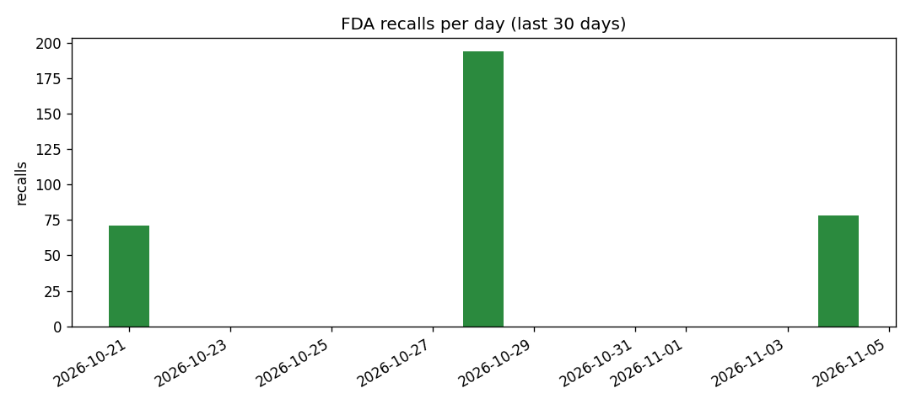

# FDA Recall Radar - daily report

Window: 2026-10-16 to 2026-11-15 (by report date). openFDA data published through 2026-11-04. Generated 2026-11-15 20:06 UTC.

**343 recalls** across 3 active days.

## By severity

| Classification | Recalls |
| --- | ---: |
| Class I | 41 |
| Class II | 265 |
| Class III | 36 |

## By product area

| Product type | Recalls |
| --- | ---: |
| Devices | 181 |
| Food | 94 |
| Drugs | 68 |

## Top recalling firms

- El Ruisenor De Mexico, Inc. (61)
- Boston Scientific Cork, Ltd. (41)
- Medline Industries, LP (32)
- ABC Compounding Co., Inc. (19)
- PRITAM INTERNATIONAL PRIVATE LIMITED (17)
- Ventec Life Systems, Inc. (12)
- PHILIPS MEDICAL SYSTEMS NEDERLAND B.V. (9)
- Pentax of America Inc (5)
- Medtronic, Inc. (4)
- Howmedica Osteonics Corp. (4)

## Highest-severity recalls in the window

- **Class I** (20261104): GF Blends Inc - Products are recalled due to potential undeclared wheat gluten
- **Class I** (20261104): EDEN BROTHERS - Salmonella
- **Class I** (20261104): Oliva on Main - contains undeclared sesame
- **Class I** (20261104): Oliva on Main - contains undeclared sesame
- **Class I** (20261104): FORTUNA MARKETING, INC - Broccoli seeds potentially contaminated with Salmonella

Data: [openFDA](https://open.fda.gov/) enforcement reports. Not medical advice.
