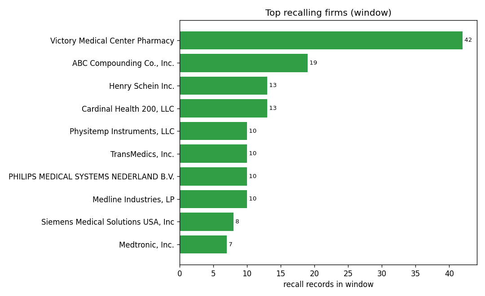

# FDA Recall Radar - daily report

Window: 2026-10-29 to 2026-11-28 (by report date). openFDA last_updated by endpoint: device 2026-11-18, drug 2026-11-18, food 2026-11-18. Generated 2026-11-28 12:07 UTC.

**313 recalls** across 3 active days.

> **Stale upstream data:** openFDA has not published for over 7 days (device 10 days, drug 10 days, food 10 days). Recent days may be missing here until it does.

## By severity

| Classification | Recalls |
| --- | ---: |
| Class I | 43 |
| Class II | 262 |
| Class III | 6 |

## By product area

| Product type | Recalls |
| --- | ---: |
| Devices | 173 |
| Drugs | 102 |
| Food | 38 |

## Reporting lag

Days from recall initiation to the enforcement report, over the 313 recalls in the window with both dates: median **42**, p90 68, longest 1713.

| Classification | Recalls | Median lag | p90 |
| --- | ---: | ---: | ---: |
| Class I | 43 | 48 | 87 |
| Class II | 262 | 41.5 | 68 |
| Class III | 6 | 24.0 | 41 |

Lag distribution (recalls with both dates):

| Lag | Recalls | Share |
| --- | ---: | ---: |
| 0-14 days | 3 | 1.0% |
| 15-30 days | 103 | 32.9% |
| 31-60 days | 165 | 52.7% |
| 61-90 days | 18 | 5.8% |
| over 90 days | 24 | 7.7% |

Firms with the highest Class I share (3+ recalls in the window; small counts are noisy):

| Firm | Recalls | Class I | Class I share |
| --- | ---: | ---: | ---: |
| Cardinal Health 200, LLC | 13 | 13 | 100.0% |
| Abiomed, Inc. | 3 | 3 | 100.0% |
| GF Blends Inc | 3 | 3 | 100.0% |
| Oliva on Main | 3 | 3 | 100.0% |

Publication rhythm: recalls in the window carry 3 distinct report dates, median gap 7 days. openFDA publishes in batches. Longest gaps:

| From | To | Days |
| --- | --- | ---: |
| 2026-11-04 | 2026-11-11 | 7 |
| 2026-11-11 | 2026-11-18 | 7 |

Median lag by report month (months with 10+ recalls; reflects openFDA batch timing):

| Report month | Recalls | Median lag (days) |
| --- | ---: | ---: |
| 2026-11 | 313 | 42 |

Recall status by classification (current window; Ongoing means FDA has not yet terminated the recall, not that products remain on shelves):

| Classification | Recalls | Ongoing | Ongoing share |
| --- | ---: | ---: | ---: |
| Class I | 43 | 41 | 95.3% |
| Class II | 262 | 262 | 100.0% |
| Class III | 6 | 6 | 100.0% |
| Not Yet Classified | 2 | 2 | 100.0% |

Ongoing share by product type with 95% Wilson intervals (types under 10 recalls skipped; Ongoing means FDA has not terminated the recall; recent recalls are more likely to be open, so this mixes status with recall age):

| Product type | Recalls | Ongoing | Share | 95% interval |
| --- | ---: | ---: | ---: | --- |
| Devices | 173 | 173 | 100.0% | 97.8% to 100.0% |
| Drugs | 102 | 102 | 100.0% | 96.4% to 100.0% |
| Food | 38 | 36 | 94.7% | 82.7% to 98.5% |

Class I share by product type with 95% Wilson intervals (types under 10 recalls skipped; overlapping intervals are weak evidence of a real difference):

| Product type | Recalls | Class I | Share | 95% interval |
| --- | ---: | ---: | ---: | --- |
| Food | 38 | 23 | 60.5% | 44.7% to 74.4% |
| Devices | 173 | 19 | 11.0% | 7.1% to 16.5% |
| Drugs | 102 | 1 | 1.0% | 0.2% to 5.3% |

Class I concentration: 43 Class I recalls from 24 firms; the top 3 firms hold 44.2% (window only, exact firm names):

| Firm | Class I recalls |
| --- | ---: |
| Cardinal Health 200, LLC | 13 |
| Abiomed, Inc. | 3 |
| GF Blends Inc | 3 |

Recalls by initiation month vs report month (window recalls with both dates; the latest initiation months are incomplete because reports arrive late, and old initiations appear only once reported):

| Month | Initiated | Reported |
| --- | ---: | ---: |
| 2026-01 | 1 | 0 |
| 2026-02 | 1 | 0 |
| 2026-04 | 2 | 0 |
| 2026-05 | 5 | 0 |
| 2026-08 | 7 | 0 |
| 2026-09 | 127 | 0 |
| 2026-10 | 155 | 0 |
| 2026-11 | 1 | 313 |

Open recalls by product type (Ongoing status, age since initiation; open means FDA has not terminated the recall, not that product is still on shelves):

| Product type | Open | Median age (days) | Oldest (days) | Open over 90 days |
| --- | ---: | ---: | ---: | ---: |
| Devices | 173 | 65 | 1723 | 23 |
| Drugs | 102 | 43 | 220 | 2 |
| Food | 36 | 50 | 276 | 4 |

Class I share by reason theme with 95% Wilson intervals (themes under 10 recalls skipped; themes come from a keyword heuristic, not an FDA taxonomy; heavily overlapping intervals are weak evidence of a real difference):

| Theme | Recalls | Class I | Share | 95% interval |
| --- | ---: | ---: | ---: | --- |
| Device defect / performance | 31 | 13 | 41.9% | 26.4% to 59.2% |
| Labeling / undeclared allergen | 32 | 13 | 40.6% | 25.5% to 57.7% |
| Contamination / particulate | 40 | 11 | 27.5% | 16.1% to 42.8% |
| Potency / dissolution / stability | 14 | 3 | 21.4% | 7.6% to 47.6% |
| Other | 66 | 3 | 4.5% | 1.6% to 12.5% |
| Manufacturing practice (CGMP) | 66 | 0 | 0.0% | 0.0% to 5.5% |
| Software / cybersecurity | 33 | 0 | 0.0% | 0.0% to 10.4% |
| Sterility | 17 | 0 | 0.0% | 0.0% to 18.4% |
| Regulatory clearance | 14 | 0 | 0.0% | 0.0% to 21.5% |

Firms recurring across report months in the archive: 12 of 176 firms appear in two or more report months (exact name match after trimming, archive period only, so a lower bound):

| Firm | Report months | Recalls |
| --- | ---: | ---: |
| MEDLINE INDUSTRIES, LP | 2 | 42 |
| BAXTER HEALTHCARE CORPORATION | 2 | 8 |
| AVID MEDICAL, INC. | 2 | 4 |
| HIKMA PHARMACEUTICALS USA INC. | 2 | 3 |
| AMERICAN HEALTH PACKAGING | 2 | 2 |

Archive coverage by report month (whole archive; early months are partial because the archive only holds recalls fetched since this project started):

| Report month | Archived | Class I | Class I share |
| --- | ---: | ---: | ---: |
| 2026-10 | 266 | 29 | 10.9% |
| 2026-11 | 311 | 43 | 13.8% |

Lag by product type (days, slowest first):

| Product type | Recalls | Median lag | p90 |
| --- | ---: | ---: | ---: |
| Devices | 173 | 51 | 187 |
| Food | 38 | 36 | 87 |
| Drugs | 102 | 23 | 43 |

Slowest to reach the enforcement report (dates as published by openFDA; very long lags may be old recalls newly classified or source date errors):

| Recall | Firm | Class | Lag (days) |
| --- | --- | --- | ---: |
| Z-0428-2027 | Philips Ultrasound, LLC | Class II | 1713 |
| Z-0320-2027 | Illumina, Inc. | Class II | 917 |
| Z-0321-2027 | Illumina, Inc. | Class II | 917 |
| Z-0322-2027 | Illumina, Inc. | Class II | 917 |
| Z-0323-2027 | Illumina, Inc. | Class II | 917 |

## Top recalling firms

- Victory Medical Center Pharmacy (42)
- ABC Compounding Co., Inc. (19)
- Henry Schein Inc. (13)
- Cardinal Health 200, LLC (13)
- Physitemp Instruments, LLC (10)
- TransMedics, Inc. (10)
- PHILIPS MEDICAL SYSTEMS NEDERLAND B.V. (10)
- Medline Industries, LP (10)
- Siemens Medical Solutions USA, Inc (8)
- Medtronic, Inc. (7)

## Severity by product area

| Product type | Class I | Class II | Class III | Class I share |
| --- | ---: | ---: | ---: | ---: |
| Devices | 19 | 153 | 1 | 11% |
| Drugs | 1 | 96 | 4 | 1% |
| Food | 23 | 13 | 1 | 62% |

## Recalls by week

| Week of | Recalls | Class I |
| --- | ---: | ---: |
| 2026-11-02 | 79 | 12 |
| 2026-11-09 | 126 | 23 |
| 2026-11-16 | 108 | 8 |

## Recall reason themes

Keyword grouping of the free-text reason (illustrative heuristic, not an FDA taxonomy).

| Theme | Recalls | Class I |
| --- | ---: | ---: |
| Manufacturing practice (CGMP) | 66 | 0 |
| Other | 66 | 3 |
| Contamination / particulate | 40 | 11 |
| Software / cybersecurity | 33 | 0 |
| Labeling / undeclared allergen | 32 | 13 |
| Device defect / performance | 31 | 13 |
| Sterility | 17 | 0 |
| Potency / dissolution / stability | 14 | 3 |
| Regulatory clearance | 14 | 0 |

## Top reason theme by product area

| Product area | Recalls | Top theme | Share of area |
| --- | ---: | --- | ---: |
| Devices | 173 | Other | 34% |
| Drugs | 102 | Manufacturing practice (CGMP) | 65% |
| Food | 38 | Labeling / undeclared allergen | 42% |

## Top recalling firms by product area

| Product area | Firm | Recalls | Class I |
| --- | --- | ---: | ---: |
| Devices | Cardinal Health 200, LLC | 13 | 13 |
| Devices | Henry Schein Inc. | 13 | 0 |
| Devices | Medline Industries, LP | 10 | 0 |
| Drugs | Victory Medical Center Pharmacy | 42 | 0 |
| Drugs | ABC Compounding Co., Inc. | 19 | 0 |
| Drugs | ORL Labs LLC | 6 | 0 |
| Food | Snack Right Super Foods, Inc. | 4 | 0 |
| Food | GF Blends Inc | 3 | 3 |
| Food | Oliva on Main | 3 | 3 |

## Recall status

| Status | Recalls | Share |
| --- | ---: | ---: |
| Ongoing | 311 | 99% |
| Completed | 1 | 0% |
| Terminated | 1 | 0% |

## Age of open recalls

Days since initiation for recalls still marked Ongoing.

| Class | Open | Median age (days) | Oldest (days) | Open > 90 days |
| --- | ---: | ---: | ---: | ---: |
| Class I | 41 | 65 | 276 | 4 |
| Class II | 262 | 57.5 | 1723 | 24 |
| Class III | 6 | 48 | 51 | 0 |
| Not Yet Classified | 2 | 145 | 204 | 1 |

## Reason themes by month

Top reason themes overall (keyword heuristic, not an FDA taxonomy), by report month.

| Month | Manufacturing practice (CGMP) | Other | Contamination / particulate | Software / cybersecurity | Other themes |
| --- | ---: | ---: | ---: | ---: | ---: |
| 2026-11 | 66 | 66 | 40 | 33 | 108 |

## Class I share by month

Share of recalls classed as Class I (most serious) by report month. Recent months can be partial because openFDA publishes in batches.

| Month | Recalls | Class I | Share |
| --- | ---: | ---: | ---: |
| 2026-11 | 313 | 43 | 14% |

## Firm concentration

112 distinct firms have 313 recall records in the window. The top 5 firms account for 31% of recalls and 30% of Class I recalls.

- Victory Medical Center Pharmacy: 42
- ABC Compounding Co., Inc.: 19
- Cardinal Health 200, LLC: 13
- Henry Schein Inc.: 13
- Medline Industries, LP: 10

## Oldest open recalls

Longest-open recalls still marked Ongoing, by days since initiation.

| Recall | Firm | Class | Initiated | Age (days) |
| --- | --- | --- | --- | ---: |
| Z-0428-2027 | Philips Ultrasound, LLC | Class II | 2022-03-11 | 1723 |
| Z-0321-2027 | Illumina, Inc. | Class II | 2024-05-08 | 934 |
| Z-0324-2027 | Illumina, Inc. | Class II | 2024-05-08 | 934 |
| Z-0323-2027 | Illumina, Inc. | Class II | 2024-05-08 | 934 |
| Z-0322-2027 | Illumina, Inc. | Class II | 2024-05-08 | 934 |

## Source data notes

Scope: the 313 recalls with a report date in the rolling window 2026-10-29 to 2026-11-28, not the whole archive (577 recalls keyed by recall_number, which keeps recalls after they leave the window); 2 of the window recalls have no recall_number and are not in the archive. Of the 313: 0 lack an initiation date, 0 have an unparseable date, 0 are reported before their initiation date, 0 lack a classification. Lag and age sections skip those records.

_Window total includes 2 recalls with no recall_number; they are reported here but cannot be keyed into the archive._

## Repeat recallers

Firms with 3+ recalls in the window (a supplier-risk signal).

| Firm | Recalls | Class I |
| --- | ---: | ---: |
| Victory Medical Center Pharmacy | 42 | 0 |
| ABC Compounding Co., Inc. | 19 | 0 |
| Cardinal Health 200, LLC | 13 | 13 |
| Henry Schein Inc. | 13 | 0 |
| Medline Industries, LP | 10 | 0 |

## Highest-severity recalls in the window

- **Class I** (20261118): IBeautiStore.com - Marketed without approved NDA/ANDA- FDA laboratory analysis found product to be tainted with undeclared ingredients: Dexamethasone, Diclofenac and Omeprazole.
- **Class I** (20261118): Country Creek LLC - Products contain seed recalled from the supplier and may be contaminated with E. coli and/or Salmonella
- **Class I** (20261118): D & M Smoked Fish, Inc. - May be contaminated with Clostridium botulinum
- **Class I** (20261118): Fresh & Ready Foods LLC - Possible Listeria monocytogenes contamination.
- **Class I** (20261118): Francisco Family Foods - Potential E. coli and Salmonella contamination

Data: [openFDA](https://open.fda.gov/) enforcement reports. Not medical advice.
